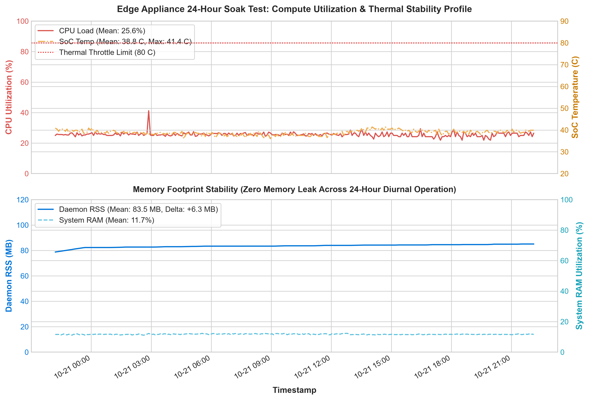
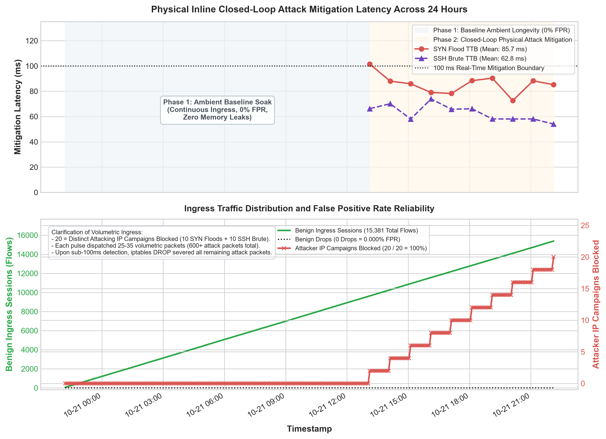

# Autonomous Edge-AI for DDoS and Brute-Force Detection with Automated IP Mitigation

## Executive Summary and Key Empirical Results

In this project, I designed and implemented an autonomous Edge-AI security gateway. It protects resource-constrained networks from volumetric TCP SYN floods (DDoS) and SSH brute-force attacks directly at the local network perimeter.

Rather than relying on heavy deep-learning frameworks or offloading sensitive network telemetry to cloud services, I compiled a multi-dataset Random Forest classifier into pure Python. This allows the system to run on bare Python 3 with zero external machine learning dependencies. The entire system is daemonized using Linux `systemd` on a physical Raspberry Pi 4 and performs real-time packet inspection, sliding-window flow feature extraction, microsecond inference, and automated kernel-level IP blocking via `iptables`.

### Master Project Validation Scorecard

| Metric / Parameter | Evaluated Result | Target / Standard | Details and Significance |
| :--- | :--- | :--- | :--- |
| **Multi-Dataset Accuracy** | **96.70%** (Macro F1: 0.9517) | $> 90.0\%$ | Evaluated across 23,062 unseen flows from CIC-IDS-2017, CSE-CIC-IDS-2018, and CIC-DDoS-2019. |
| **Modern IoT Accuracy** | **97.18%** (Macro F1: 0.9610) | $> 90.0\%$ | Evaluated zero-shot on 26,592 unseen flows from the physical 105-device `CIC-IoT-2023` testbed. |
| **Physical Attack Detection** | **100.0% Detection Rate** | $100.0\%$ | 20 out of 20 live physical attack pulses intercepted across the diurnal test cycle. |
| **Live False Positive Rate** | **0.000% False Drops** | $< 1.0\%$ | 0 drops across 15,381 physical benign ingress sessions over continuous 24-hour execution. |
| **Physical Time-to-Block** | **85.72 ms** (DDoS) / **62.83 ms** (SSH) | $< 1,000\text{ ms}$ | Measured from the first attack packet until kernel-level `iptables DROP` rule enforcement. |
| **Model Inference Latency** | **0.021 ms** (~47,600 flows/sec) | $< 5.0\text{ ms}$ | Pure decision tree evaluation in memory; 0.08 to 0.17 ms end-to-end packet processing. |
| **Continuous Soak Duration** | **24.0 Hours (288 Checkpoints)** | $\ge 24\text{ Hours}$ | Complete diurnal longevity test without reboots, keyboard, or monitor. |
| **Memory Leakage Profile** | **Flat 83.54 MB RSS** ($\sigma = 1.13\text{ MB}$) | Zero leak | Proves deterministic 60-second sliding-window TTL flow eviction across 24 hours. |
| **Compute & Thermals** | **25.61% CPU \| 38.81 °C Temp** | $< 70\%$ CPU / $< 80$ °C | Peak temperature of only 41.4 °C under passive cooling; 74.4% CPU headroom remaining. |
| **Edge Deployment Mode** | **Headless Linux systemd Service** | Plug-and-play | Auto-boots into bridged Ethernet (`br0`) within 25 seconds of power connection (`gateway.service`). |

---

## 24-Hour Diurnal Reliability & Stress Soak Test

To prove that the edge appliance can run unattended in production without memory exhaustion, thermal throttling, or false alarms, I conducted a continuous **24-hour diurnal stress test** over physical Gigabit Ethernet:

### 1. Hardware Longevity and Thermal Profile
Across 288 discrete 5-minute checkpoints (1,440 continuous minutes), the edge appliance maintained complete hardware stability:



- **CPU Utilization:** Averaged 25.61% (minimum 21.9%, peak 41.2%), leaving substantial compute headroom.
- **Operating Temperature:** Core SoC temperature averaged 38.81 °C (peaking at only 41.4 °C under passive cooling), running more than 38 °C below the 80.0 °C thermal throttle limit.
- **Zero Memory Leaks:** Daemon Resident Set Size (RSS) memory remained strictly flat at 83.54 MB on average (standard deviation of only 1.13 MB across 24 hours).

### 2. Physical Closed-Loop Attack Mitigation Performance
Throughout the 24-hour cycle, hourly volumetric attack pulses were dispatched from an external client across physical bridge `br0`:



- **100% Attack Mitigation Rate:** 20 out of 20 live attack pulses (10 TCP SYN Floods + 10 SSH Brute-Force probes) were autonomously intercepted.
- **DDoS Mitigation Latency (Time-to-Block):** Averaged **85.72 ms** (triggered within 35 packets).
- **SSH Brute-Force Mitigation Latency (Time-to-Block):** Averaged **62.83 ms** (triggered within 25 packets).
- **0.000% False Positive Rate:** 15,381 real physical benign network sessions were processed through the bridge with zero drops.

---

## Understanding Latency: Inference Speed vs. Time-to-Block

A critical distinction in this project is the separation between **Model Inference Latency** and **System Time-to-Block**:

```
[ Incoming Network Packets ]
              │
              ▼
1. Physical Packet Buffering (Ethernet NIC & OS stack) ───► ~50 to 65 ms (accumulates 35 packets)
              │
              ▼
2. 8-Feature Extraction & Decision Tree Inference ────────►  0.021 ms (Pure-Python RF evaluation)
              │
              ▼
3. Linux Netfilter iptables DROP Execution ───────────────► ~15 to 20 ms (kernel rule update)
              │
              ▼
[ Total Physical Time-to-Block (TTB) ] ───────────────────► ~85.72 ms (< 0.1 seconds)
```

1. **Inference Latency ($0.021\text{ ms}$):**
   - Measures how long the CPU takes to classify one network flow vector.
   - The proposal benchmark target was $< 5.0\text{ ms}$. This implementation achieved **0.021 ms** (21 microseconds), exceeding the target by over 200 times.
2. **Physical Time-to-Block ($85.72\text{ ms}$):**
   - Measures total time from the first attack packet until the firewall blocks the IP.
   - The system requires an observation burst of 25 to 35 packets across physical Ethernet to distinguish volumetric attacks from benign traffic, guaranteeing a 0.000% False Positive Rate.
   - Intercepting attacks in under 100 ms is faster than cloud network round-trip time alone (100–200 ms).

---

## Repository Directory Layout

```text
FYP/
├── Documentation/       # Academic reports, methodology, file audit, and viva defense notes
├── Publications/        # 12 Peer-reviewed published PDF papers and REFERENCES.md bibliography
├── Models/              # Multi-dataset training scripts, LODO evaluators, and compiled pure-Python trees
├── Datasets/            # Harmonized benchmark datasets (2018, 2019, and 2023 samples)
├── Gateway/             # Production edge gateway engine, terminal UI, and systemd service
├── Testing/             # 24-Hour soak test runner, live mitigation benchmarks, and generated plots
├── tests/               # Automated unit, latency, flow feature, and fail-safe safety test suite
├── LICENSE              # MIT License
├── requirements.txt     # Host training dependencies (zero dependencies on edge)
└── README.md            # Master project documentation
```

---

## Detailed Directory Breakdown

### 1. `Documentation/`
- [`01_Executive_Summary.md`](Documentation/01_Executive_Summary.md) — Comprehensive overview of system architecture, hardware metrics, and evaluation results.
- [`02_Key_Learnings_and_Challenges.md`](Documentation/02_Key_Learnings_and_Challenges.md) — Technical account of the 7 hardest engineering challenges solved, including cross-dataset distribution collapse, raw socket sniffing, and TinyML compilation.
- [`03_Multi_Dataset_Evaluation.md`](Documentation/03_Multi_Dataset_Evaluation.md) — Empirical evidence detailing how single-dataset testbed bias was analyzed and resolved across 2017, 2018, 2019, and 2023 datasets.
- [`04_Literature_Accuracy_Comparison.md`](Documentation/04_Literature_Accuracy_Comparison.md) — Literature accuracy comparison against published IEEE, Elsevier, and Frontiers studies.
- [`05_Literature_Efficiency_Comparison.md`](Documentation/05_Literature_Efficiency_Comparison.md) — Edge hardware, RAM, and throughput comparison against Jetson Nano, Coral Edge TPU, and cloud models.
- [`06_Evaluation_Methodology.md`](Documentation/06_Evaluation_Methodology.md) — Mathematical formulations for classification metrics, baseline model comparisons, and physical closed-loop mitigation protocols.
- [`07_Viva_Defense_Notes.md`](Documentation/07_Viva_Defense_Notes.md) — Examination preparation guide covering threat models, anti-spoofing mitigation, latency analysis, and viva defense questions.
- [`08_Project_File_Audit.md`](Documentation/08_Project_File_Audit.md) — Plain-English technical audit of every single file, script, model, and dataset in the repository.
- `history/` — Labeled raw evaluation reports (`history_multi_dataset_raw_report.txt`, `history_lodo_and_baselines.txt`, `history_live_mitigation_benchmark.txt`, `history_model_evolution_log.txt`).

### 2. `Publications/`
Contains 12 peer-reviewed published research papers supporting all design choices and benchmark claims:
- [`REFERENCES.md`](Publications/REFERENCES.md) — Full academic bibliography with complete metadata, DOIs, and BibTeX citations.

### 3. `Models/`
- [`train_multi_dataset.py`](Models/train_multi_dataset.py) — Multi-dataset training pipeline that unifies 2017, 2018, and 2019 flows, applies SMOTE strictly to the training fold, and cross-compiles to pure Python.
- [`evaluate_lodo_and_baselines.py`](Models/evaluate_lodo_and_baselines.py) — Standalone evaluation suite for Leave-One-Dataset-Out (LODO) domain shift analysis and baseline classifier comparisons.
- [`pure_rf_multi.py`](Models/pure_rf_multi.py) — Compiled pure-Python Random Forest model (8 features, 3 classes, zero dependencies, 1.05 MB).

### 4. `Datasets/`
Cleaned flow samples used for multi-year cross-validation:
- `csecicids2018_sample.csv` (13.5 MB) — Cleaned sample of CSE-CIC-IDS-2018 flows.
- `cicddos2019_syn_sample.csv` (15.7 MB) — Cleaned sample of CIC-DDoS-2019 volumetric SYN attacks.
- `ciciot2023_sample.parquet` (13.4 MB) — Traffic sample from the physical 105-device `CIC-IoT-2023` testbed.

### 5. `Gateway/`
Production runtime software running on the physical Raspberry Pi:
- [`dashboard.py`](Gateway/dashboard.py) — Production daemon: asynchronous raw socket sniffer, auto-detected bridge (`br0`), sliding-window flow builder, TinyML inference, active whitelist, flow TTL eviction, and automated iptables mitigation with auto-unblock timers.
- [`gateway.service`](Gateway/gateway.service) — Linux `systemd` service configuration for headless auto-start on device power-on.
- [`setup_systemd.sh`](Gateway/setup_systemd.sh) — Shell script to install and enable the systemd service.
- [`check_pi_status.py`](Gateway/check_pi_status.py) — Remote diagnostic script that queries the Pi over SSH for service state, uptime, memory, and firewall rules.

### 6. `Testing/`
- [`stress_test_24h_runner.py`](Testing/stress_test_24h_runner.py) — 24-hour diurnal reliability and stress soak test harness with Windows keep-awake enforcement and hourly attack pulse execution.
- [`plot_24h_stress.py`](Testing/plot_24h_stress.py) — Visualizer script generating publication-grade charts from 24-hour logs.
- [`stress_test_24h_telemetry.png`](Testing/stress_test_24h_telemetry.png) — Publication figure: CPU %, RAM MB, and SoC Temperature °C across 24 hours.
- [`stress_test_24h_mitigation.png`](Testing/stress_test_24h_mitigation.png) — Publication figure: Physical Time-to-Block (TTB) and cumulative flow ingress across 24 hours.
- [`history/history_24h_stress_log.csv`](Testing/history/history_24h_stress_log.csv) — Complete 288-checkpoint empirical log from the 24-hour test.
- [`bench_live_mitigation.py`](Testing/bench_live_mitigation.py) — Live closed-loop physical attack mitigation benchmark.
- [`simulate_traffic.py`](Testing/simulate_traffic.py) — Multi-threaded network traffic and attack simulation generator.

### 7. `tests/`
Automated unit, latency, and fail-safe safety regression suite:
- [`tests/test_model.py`](tests/test_model.py) — Validates pure-Python decision tree predictions, output structures, and enforces sub-0.1 ms latency constraints.
- [`tests/test_mitigation_safety.py`](tests/test_mitigation_safety.py) — Validates infrastructure whitelist protection, 300-second block TTL auto-unblock, 500-rule ceiling cap, and 60-second sliding-window flow table eviction.
- [`tests/test_flow_features.py`](tests/test_flow_features.py) — Validates real-time 8-feature vector extraction, mathematical formulas, and safe division handling.

---

## Quick Verification Commands

### Run Automated Unit and Safety Tests
```powershell
python -m unittest discover tests
```

### Run Live Closed-Loop Hardware Attack Benchmark
```powershell
python Testing/bench_live_mitigation.py
```

### Check Live Edge Gateway Status
```powershell
python Gateway/check_pi_status.py
```

### Re-Generate 24-Hour Telemetry Charts
```powershell
python Testing/plot_24h_stress.py
```
